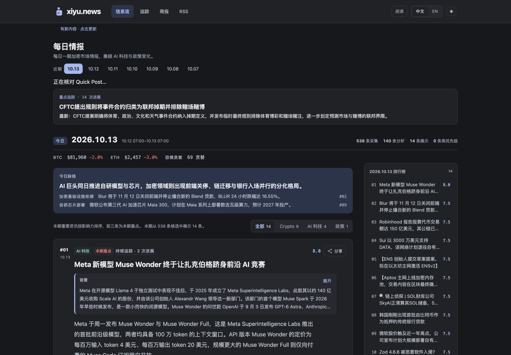
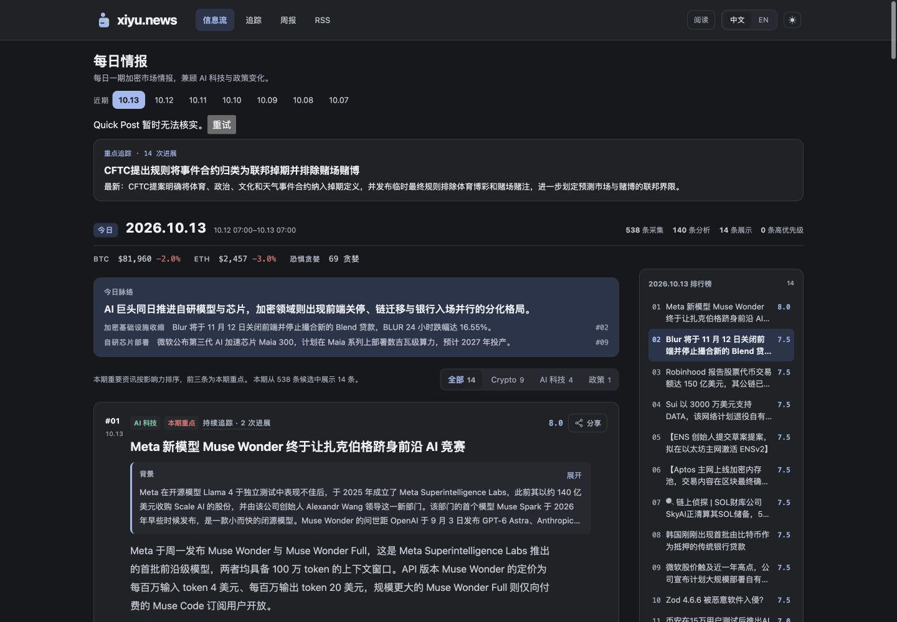

# 第8项：前端性能与真实阅读验收

Source commit: 合并后记录，前置d910e1a771816ad71db0ff818c7058186668b09e
Worker version: 部署后回读，目前71758451-e70a-401b-beb1-74015e1a029c
Deployment: 当前PR通过后正常Deploy Docs和统一Worker发布，不手工改产物分支
Verification: 34Node前端/分享/PWA/压缩测试通过；基线1098应用/4跳过，合并7与UA修正后19相关测试通过。实际压缩9文件229472B->154435B（约33%，原始总字节，非首屏全部传输字节）。本地真实浏览器1440×1000、390×844，两期27条/昨日13条、中英追踪无溢出、27原生details默认关闭及键盘打开、完整分享1320×4176确认。生产验收待合并发布。
Rollback: 已知Worker71758451，任何真正回退另行授权；新fingerprint与完整cache输出绑定，旧离线版本留存，不清理读者书签。

保持现行UI、内容密度、全正文和原生折叠，不改变字体/圆角/导航。原分享模块已经按需加载、第二天桌面已延后布局，不重复宣称新增。新规则只推迟首屏后卡片布局，全文仍在DOM，打印不受影响；浏览器不支持时按原布局阅读。使用现有锁定工具生成压缩副本，源码保持可读，法律标记保留，不处理第三方主题文件；minifier只在cache miss运行，随后整站与每文件hash验证后缓存。两份config指纹同步sha256-6884d3c7dc35。

初始curl传输：首页157501B/约1.06s、追踪93636B/约1.34s，只作为该次网络请求，不冒充浏览器WebVitals或恒定速度提升。实际首屏/日期/追踪/分享在真实浏览器回读。

| 改前桌面1440×1000 | 改后本地桌面1440×1000 |
| --- | --- |
|  |  |

手机390×844：[暗色稿](../ui-proof/server-optimization-20261013/after-local-mobile-dark.jpg)。这些是本地视觉证据，不能冒充生产已部署或真机安装。

验收发现自站对Python默认UA返回403，导致部署快跳过和备份网站版本清单保守降级。采用明确xiyunews-publication-validator/1.0标识，服务器真实HTTP200；不调整防护、认证或DNS，缓存入口依然严格无跨域重定向。修复当前两个有限校验请求；生产快跳过及新备份清单随后验收。
