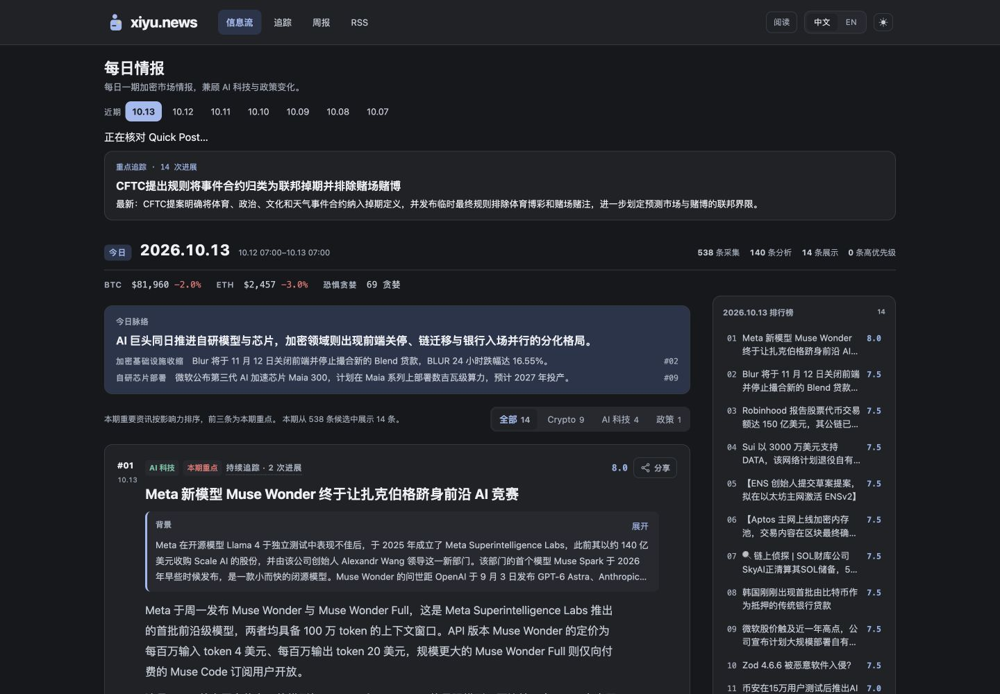
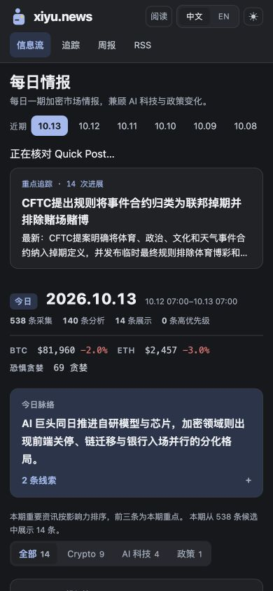

# 九项服务器优化：全部生产验收完成

Source commit: 主应用757e44bea5ba377e447d8f7e0e6add74821cd34c，备份收尾ebc92b4597e7e17446b1e65b0eb1573e80a3d8b1
Worker version: 81129031-ed6a-44bf-870a-ad1913c3336f
Deployment: 38412051393采集、38412824060统一发布成功，产物01a728b7269e743a96dcf9aa0202d3eada0f5691；备份按PR279合并代码在原受限单元部署成功。
Verification: 1111应用通过/4既有条件跳过、CI38414738476全部适用检查通过；正常SQLite采集/发布、前端阅读与双库异机恢复完成。
Rollback: 保留Git审计快照与7份加密备份，实际回退另行授权，不重置回执、不重发未知消息。

## 结果与证据

| 项目 | 最终证据 |
| --- | --- |
| 来源 | PR259已部署，原RSS失败才同发布者公开索引替代，403/headline-only与真实来源记录保留。 |
| CI | PR261/263，文档仅治理/范围选择，未知与跨模块完整回归；PR277/279所有适用检查通过。 |
| 恢复 | PR265，边缘和服务器guardian在用，有次数/冷却预算，不重启活跃任务或实时发送者。 |
| 缓存与Token | PR269/277，采集38412051393：300采集/82新增/1320staging，3实质进展/3关系命中/23miss/9证据延后、218652tokens，分类失败1不缓存。 |
| 构建 | PR271/275，完整252s/缓存复用96s；38408807579同输入24s跳过安装/构建/部署。 |
| 隔离与SQLite | PR273/277，main可信生产者独立业务库；38411818537原样导入4000分析/47关系/3预筛选/6文档，CI/PR隔离；发送前Git检查点、sent/unknown保护保留。 |
| 前端 | PR275，生产两期27条/历史13条/手机暗亮/中英追踪无溢出，details折叠和键盘使用、完整长图1320×3234、0网页错误；9资源229472B->154435B约33%，不是首屏网络/WebVitals保证。 |
| 备份 | PR267/279，20261013T144920Z、68秒/13.636s CPU、6820048B成功；仅整理隔离副本，现役库不VACUUM。原128MiB/20%CPU/8MiB导出、7版本/3天保留不变。 |
| 异机恢复 | 私有Artifact38417087420上传成功，本机下载age解密/自动识别xz，双库SHA、完整性和所有表计数匹配；主库4072缓存/6文档/1报告/51任务，实时库全部记录保留，明文清理。 |

加密文件SHA：06694a0dd1dec2c84821c3e3c8392809b756c55cc334cdd29be24743dfaf3049，本机私有副本目录 `/Users/minutesdr/.local/share/xiyunews/backups/20261013-run38417087420`。实时PID235825/NRestarts0不变，三个现货分片live、queue0、Telegram启用；既有Hyperliquid仍degraded，不能宣称全部ready。执行器OOM与oom_kill为0，guardian/backup/maintenance定时器均运行。

## 生产视觉证据

| 桌面1440×1000 | 手机390×844暗色 |
| --- | --- |
|  |  |

[生产追踪](../ui-proof/server-optimization-20261013/production-tracking.jpg)保留6重点事件，真实新进展、日期、背景和参考资料。手机模拟不是真机安装/收件，未来自然故障恢复未人为制造；系统仍依赖GitHub控制面与单服务器，不新增付费服务，不承诺固定AI降费或高可用。Quick Post登录后验收不属本轮，其他待办只按运营者新指令执行。

本记录是本日各阶段最终生产状态，过程记录保留作审计。[九项计划](../server-optimization-plan.md)全部完成，[系统架构](../system-architecture.md)为唯一架构入口，[交接](../handoff.md)为维护者第一入口。总任务257待最终文档PR合并后关闭。
