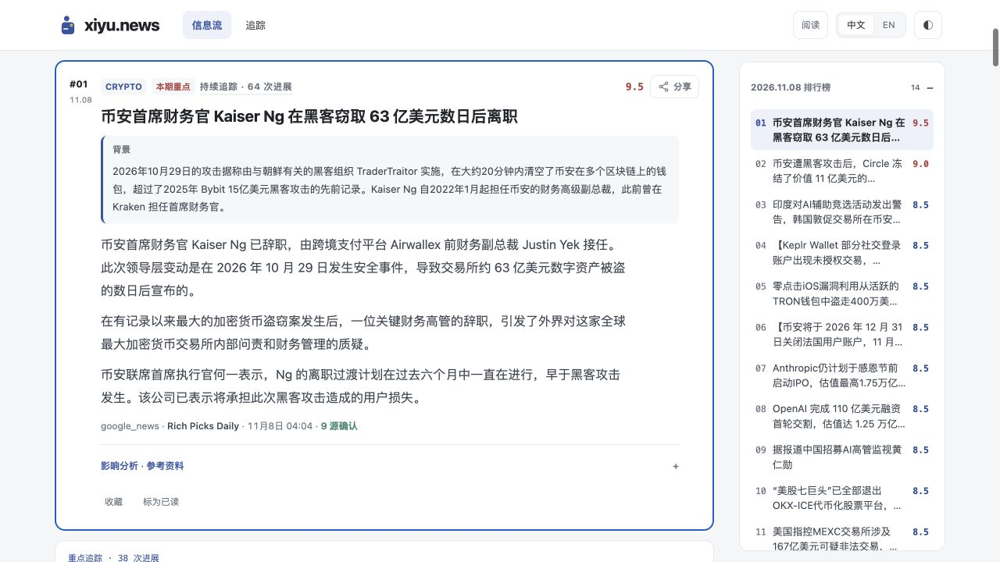
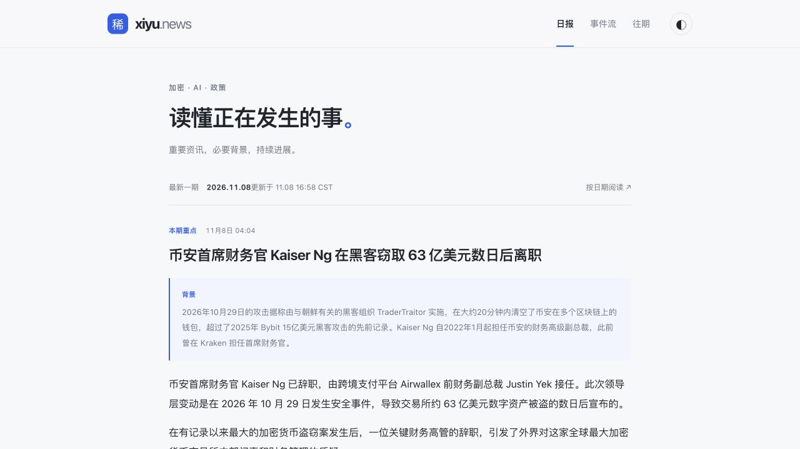
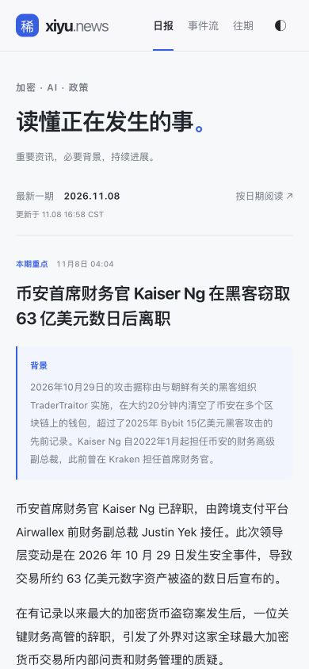
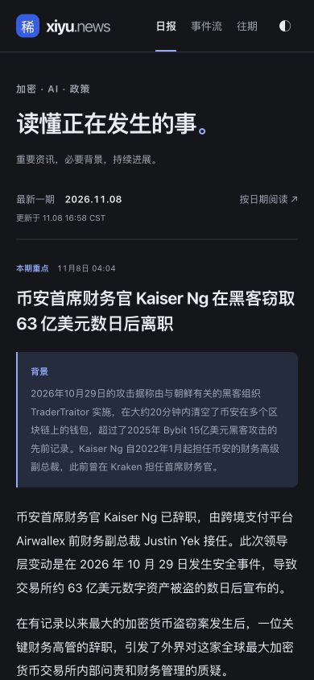
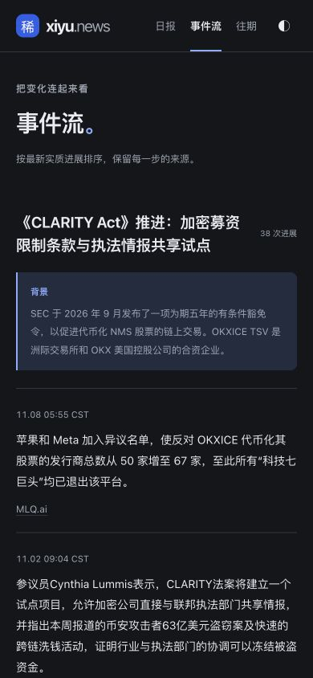

# 核心版整站精简与首页重建

Issue: https://github.com/ohxiyu/xiyunews/issues/343

用户授权：人工纠错去掉，其余按已批准方案执行，英文实现保留但功能关闭，完成后直接上线。唯一编辑与整合负责人：本聊天 Codex；分支 agent/lean-news-site。

## 交付范围

- 中文日报、事件流与详情、日期历史、Telegram 日报、主题切换和复制链接。
- 首页单期：前三条完整背景/正文/真实来源时间，最多三条事件进展，其余原生 details 展开。移除重复日期大栏、窗口/采集统计、排行、行情、分类控制、无限滚动和图片分享。
- core_only 生产配置；英文代码与旧双语渲染器保留，线上英文入口重定向中文。不再生成英文日报。
- 人工纠错、后台写接口、Quick Post、编辑插入、广告/屏蔽入口停用。X、Square、邮件/Webhook、群消息与过多发现接口退出生产执行路径。
- 日报不等待事件 AI、行情/概览 AI 或消息发送。事件 AI 独立计算，发布环节仍使用既有共享锁，且只写事件资产；日报/采集不覆盖事件权威目录。Telegram 独立发布后执行，持久 one-shot 回执在 HTTP 前提交，未知结果不重试。
- 07:00 上海窗口、07:26 主调度、独立恢复检查、评分去重/证据/成本限制、历史 URL、独立 realtime 服务和原有数据库/密钥/队列状态保留。
- 历史页面从完整已发布 HTML 无 AI 转换，保留文章 ID、正文和内容 revision；不以截断 API 重建正文。已发布日报不重复发送。
- 旧离线 worker 通过注销/自有缓存清理退出；不清空其他偏好或数据库。

## 五阶段

Code: complete
Tests: local complete; remote CI pending
PR merged: pending
Deployed: pending
Production verified: pending

本记录尚无上线完成声明。待补齐本地回归、真实 Jekyll CI、桌面/手机/暗色与生产校验。

Source commit: pending
Worker version: pending
Deployment: pending
Verification: pending
Rollback: 经授权从已知来源 SHA 通过同一流水线回退；不手改生成分支，不改 receipt 或 realtime。

## 本地验收

- Python：1235 passed、4 既有 skipped；本地缺少未修改的 media-kit ZIP，品牌二进制测试留给完整远程 CI，不删除或跳过 CI 检查。
- Edge TypeScript：类型检查通过；135 个 Worker 测试通过。核心路由与历史 JS 测试均通过。
- 浏览器用真实已发布日报和三个公开事件证据文档渲染预览；完整 Jekyll 渲染由远程 edge-build 检查，预览不是生产截图。
- 桌面 1280×720、手机 390×844、暗色；14 篇完整 DOM、11 篇折叠，手机文档宽度 390；复制成功，文章4锚点自动展开。首事件38条、另一事件3条。
- 未重跑 AI、未发送 Telegram，当前历史正文和 revision 保留；不宣称本地预览等同上线。

PR: https://github.com/ohxiyu/xiyunews/pull/344

首轮 CI 的治理检查发现关于页把站点绝对路径当作本地文件链接；已改回正式 HTTPS URL。补充核心提示缓存键、英文尾斜杠跳转和独立事件 checkpoint 回归，全部必要检查继续执行。
