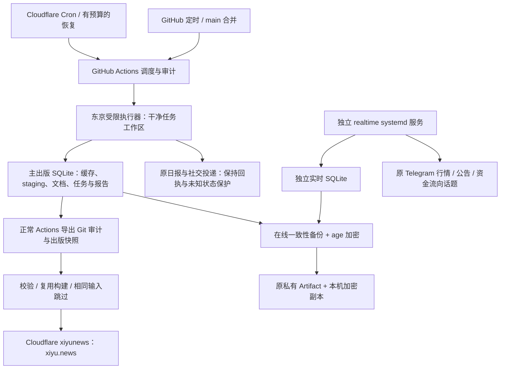

# xiyu.news 服务器架构与维护入口

代码只以私有仓库 ohxiyu/xiyunews 的 main 为准。GitHub Actions 继续负责触发、执行记录与审核，计算工作由已有东京服务器的受限执行器完成；Cloudflare 的 xiyunews 项目提供静态网站、API 与原调度/看门狗入口。主出版应用与实时提醒同仓库、同服务器，但运行用户、依赖、进程、数据库与投递目的地分离。

## 各部分的职责

| 部分 | 职责与入口 | 维护边界 |
| --- | --- | --- |
| main 应用 | src/、docs/、project-docs/handoff.md | 上海 07:00 刊期；正常采集只分析新增或证据变化，旧评分与关系缓存复用。 |
| 执行器 | ops/runner/、xiyunews-runner.service | 无 sudo/SSH 权限；CPU、内存与并发受限，保留工具缓存并清理自己的任务工作区。 |
| 主 SQLite | /home/xiyunews-runner/state/publication.sqlite3 | 可信 main 生产者才读写业务；CI/PR/预览隔离；Git 快照用于出版和审计。 |
| 实时服务 | realtime/、realtime/docs/handoff.md | 原 systemd、服务器路径、配置、规则、群与话题保持；不与主 SQLite 混用。 |
| 统一边缘项目 | ops/daily-dispatcher/、cloudflare-unified.yml | 校验精确 source/artifact 和每个缓存文件，保留运行变量；已有主域、Access 与 Cron 不另建副本。 |
| 恢复与备份 | ops/runtime/、ops/backup/、server-backup.yml | 有次数/冷却预算；不重启活跃任务或实时发送者，不恢复未知投递为可重发。 |

## 维护顺序

维护者先读 AGENTS.md、当前交接和[九项执行计划](server-optimization-plan.md)，从 origin/main 创建自己的 agent 分支。变更路径选择相关 CI，未知路径与跨模块改动保守跑全检查；主应用与实时依赖保持分开。与 main 同步、检查通过后按原授权合并，生产快照仍仅由正常工作流生成，不手改 gh-pages 或投递队列。

检查运行时要分别确认调度、采集、Git 产物、边缘版本和发送回执。任务 hook_completed 只表示任务清理结束，GitHub 的真正结论才决定成功；health 的总状态不能代替各实时分片和依赖健康。相同输入的部署可以成功跳过，网站的应用 source SHA 因文档-only 合并而落后于 main 并不等于未上线代码，需要同时核对构建 key 与产物 SHA。

publication-state.yml 只读原审计分支，导入缺失状态并证明内容哈希一致，不发送、不使用 AI，重复运行不覆盖现役状态。备份恢复只在隔离目录验证完整性、SHA 和表计数，不能启动第二个发送者；明文验证后清理，保留加密副本。保留已有额度，不新增付费套餐或主机。
