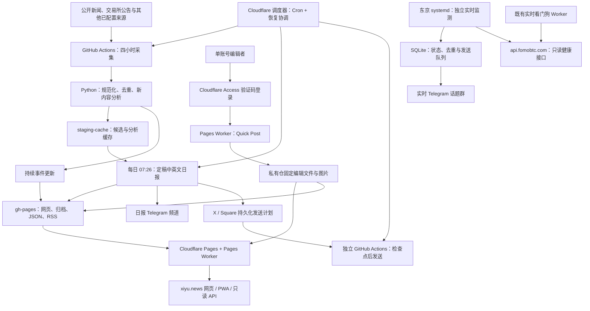

# 稀有News 系统架构

本文件描述当前实际架构，不把已写代码、已合并、已部署和已验收混为一谈。当前主仓为私有的 ohxiyu/xiyunews，正式网站为 https://xiyu.news；fomobtc 的完整历史仅准备在本地，尚未进入远端 main，实时生产仍从原仓版本运行。最终版本和待办以 [当前交接](handoff.md) 为准，迁移过程见 [发布记录](releases/2026-10-01-final-audit.md)。

## 1. 总体结构

系统有三个分离的部分：GitHub Actions 执行采集、分析和定稿；Cloudflare 提供网页、只读接口、后台认证与调度；东京服务器运行实时提醒。网站不是在浏览器里调用 AI，也不是实时行情前端。实时服务只通过自己的 Telegram 话题群输出，不混入日报频道或首页。

图中的 realtime 是运行系统，不代表代码已并入主仓。计划的 realtime/ 只整合代码管理与 CI，不合并运行进程、依赖、数据库或 Telegram 目标。

## 2. 模块与部署边界

| 模块 | 代码入口 | 执行位置 | 主要职责 |
| --- | --- | --- | --- |
| 内容管线 | src/main.py、src/orchestrator.py、src/scrapers/、src/ai/ | GitHub Actions 的 Python 任务 | 采集、去重、评分、选稿、翻译和扩写；缓存有效结果。 |
| 网页与公开数据 | docs/、Jekyll 模板、src/orchestrator.py、src/site_pages.py、src/weekly.py | Actions 生成，Cloudflare Pages 构建 | 日报、连续信息流、事件线、实体、周报、订阅与 JSON 输出。 |
| 站点边缘层 | docs/_worker.js | Cloudflare Pages 的 Workers 运行时 | 内容协商、接口路由、缓存、旧域停用、Quick Post 读写及认证校验。 |
| 独立调度器 | ops/daily-dispatcher/src/ | Cloudflare Cron + 既有 RecoveryGate Durable Object | 检查日报缺失、受限补发、四小时采集和分发到期门控。 |
| 人工编辑 | src/quick_posts.py、data/editorial.json、站点后台 | Access 保护的 /s/ 与 Pages Worker | 不调用 AI 的快速发布，保留人工编辑身份和原始内容。 |
| 社交分发 | src/x_queue.py、src/services/x_delivery.py、src/square_plan.py、src/square_delivery.py | 独立 GitHub Actions | 持久化计划、到期发送、保留回执，未知结果不自动重发。 |
| 实时提醒 | 原 fomobtc；计划导入 realtime/ | 东京 systemd 服务 fomobtc | 三个币安现货分片、公告与链上监测，输出到独立话题群。 |

前端仍是静态模板和原生 JavaScript/CSS，不是 React 应用，没有因为视觉调整引入一套前端组件服务。PWA 增加安装、离线阅读、阅读状态和更新提示，不新增服务器常驻进程；本站没有引入 D1、Redis、Kafka 或独立用户数据库。

## 3. 数据如何流动

### 3.1 四小时采集与每日定稿

Feed Collection 每四小时补采候选，复用有效分析结果，并对真实新进展更新事件线。每日刊期仍固定一次：上海时间 07:26 启动，内容窗口为前一日 07:00 至当日 07:00；07:26 是开始生成而非保证已可见时间。因此，“今天采集成功”不代表首页当天固定日报已经重写；事件线、候选暂存和日报是不同结果。

分析缓存的键包含来源输入、模型及相关分析规则。输入和配置没有变化、缓存有效时复用；新内容、修订内容、模型或规则变化、过期缓存仍可能调用 AI。系统不能承诺永远只付第一次的费用，也没有独立的生成后事实核验器；读者应核对原始来源，运行报告应如实记录扩写或翻译降级。

### 3.2 存储职责

| 位置 | 保存内容 | 写入方和边界 |
| --- | --- | --- |
| main | 应用、配置样例、治理文档与固定人工编辑数据 | 代码经 PR 合并；已授权后台只能写预定编辑文件和图片，不是任意代码代理。 |
| staging-cache | staging-items.json、analysis-cache.json | 正常管线的数据提交，保留父历史，不手动写、不 force。 |
| gh-pages | 已发布网页、日报状态、归档、事件与公开 JSON/RSS | 正常出版工作流生成；不与 main 混合、不手改。 |
| x-queue | X v2 计划、任务时间、状态与回执 | 分发工作流在发送前后持久化检查点。 |
| square-queue | 广场每日计划、发送结果与回执 | 独立分发工作流，已尝试任务不重新当作未发送。 |
| Actions cache / artifact | 缓存副本、机器可读运行报告 | 缓存可失效；报告用于核对采集、tokens 和执行结果。 |
| 东京 SQLite | 实时监测状态、去重和消息队列 | 实时服务独立管理，不由网站或日报读写。 |

### 3.3 Quick Post

编辑者先通过 Access 的单账号验证码登录，再由 Pages Worker 验证 JWT、允许身份、目标域、同源请求和输入格式。内容写入私有仓的固定位置，图片使用内容哈希标识；公共 Quick Post 接口即时读取编辑结果，正常 Actions 再生成静态页面。读取失败必须明确报错，不能以旧内容伪装发布成功；后台、写接口和鉴权响应不进入公共缓存。

### 3.4 Telegram、X 和币安广场

日报频道与实时话题群是两个独立目标。X 按当天选定故事生成持久化计划，后续任务依据前次实际发送时间计算间隔；币安广场使用自己的每日计划。发送前先写 pending 并成功持久化，收到确定回执再记 sent；超时、结果不明确或进程中断进入 unknown，禁止自动重发。

Worker 每五分钟只读私有队列判断是否需要启动任务，不直接访问发帖接口、不持有社交发帖凭据。未到期则 idle，X 与广场独立派发；正常发布事件和小时级 GitHub schedule 保留备用。平台同时故障时仍可能延迟，不能用无限重试或清空队列“恢复”。

## 4. 网页、缓存与域名

Cloudflare Pages 从 gh-pages 构建生产站，main 和代码分支用于预览。状态分支 staging-cache、x-queue、square-queue 不应触发网站预览，以免消耗构建次数且生成无意义失败。HTML、公开 API、订阅和静态资源有不同的缓存期限；新部署成功后，旧边缘缓存可能短暂保留，验收必须回读普通主域链接，不能仅验证带查询参数的请求。

PWA 的离线内容可能不是最新一期，必须显示保存状态并保留匹配的资源版本。后台、凭据、私有接口不允许离线缓存；域名改变后浏览器 origin 改变，原收藏、草稿和安装状态不能假定自动迁移。只在新域安装和使用后台。

运营者最新决定取消旧域入口及 301：bmt.news 和 www.bmt.news 由 Worker 返回 410，不再显示网站或后台，不跳到新域。DNS、注册与 TLS 资源不删除，已安装在旧域的浏览器缓存也不会远程强制抹除。新主域网页站名为 xiyu.news，中文品牌为稀有News；公开联系只链接 [X @ohxiyu](https://x.com/ohxiyu)，不公开私人邮箱或 Telegram。

## 5. 安全、成本与运维

密钥只在 GitHub Secrets、Cloudflare Secrets 和服务器环境文件中使用，不进入 Git、浏览器脚本、公开 API、架构图或日志。私有仓内容通过鉴权 Contents API 读取，禁止带凭据跟随第三方重定向；内容与模型返回都是不可信输入，保留 URL 校验、输出转义和输入限制。Access 与 Worker 双重校验，私有仓不能代替撤销已泄露凭据。

主要可变成本是 AI 输入/输出、私有 Actions 执行时间、网站 Worker 请求和既有服务器。有效缓存降低重复分析；到期门控降低空 runner；Quick Post、普通阅读、调度检查和实时规则不因每次动作调用 AI。它们不等于系统总成本为零；当前没有新增付费套餐，实际账单和剩余额度需在各平台核实。

日报恢复使用按刊期命名的 Durable Object 租约、重试预算与冷却期；先确认产物，再确认生产页面，产物有而页面未更新时优先处理部署，不重跑 AI。采集、缓存持久化、Pages 构建、社交回执和实时健康必须分别验收。/health 可用不等于完整就绪；实时 Hyperliquid 的既有降级会使 ready 失败，不能隐藏或写成迁移后全部正常。

当前套餐不能提供私有仓分支保护和 CodeQL 授权，未购买升级；已有 CI、依赖审计、治理和整合负责人的 main/检查核对继续执行，但不能宣称等价于平台强制保护。每个变更仍保持一个 Issue、一个 agent 分支和一个 PR，部署后的真实证据以文档 PR 回写。

## 6. 尚未完成的迁移依赖

1. 完整历史导入前，需确认旧历史中疑似 Telegram 凭据已撤销；本地准备不等于主仓已有 realtime/，不能先推再撤销。
2. 实时服务的新仓发布需提供原 SSH 配置入口，按原部署路径备份、切换、核对完整 source_commit、三个现货分片、自然推送回执和看门狗，再归档旧仓；不改数据库、systemd、规则或目标群。
3. Telegram 名称和简介仍需运营者确认并修改，建议频道“稀有News”、话题群“稀有News · 实时快讯”，两者简介加入 xiyu.news；不把文案准备说成改名完成。
4. 新域后台的匿名登录入口已恢复；验证码登录后的 Quick Post 读写仍须验收，不发布生产测试新闻或绕过认证。

以上限制不是新的技术架构，只是尚未满足的安全与运营条件。后续仍沿用这三个独立运行边界，不为了迁移引入额外系统。
